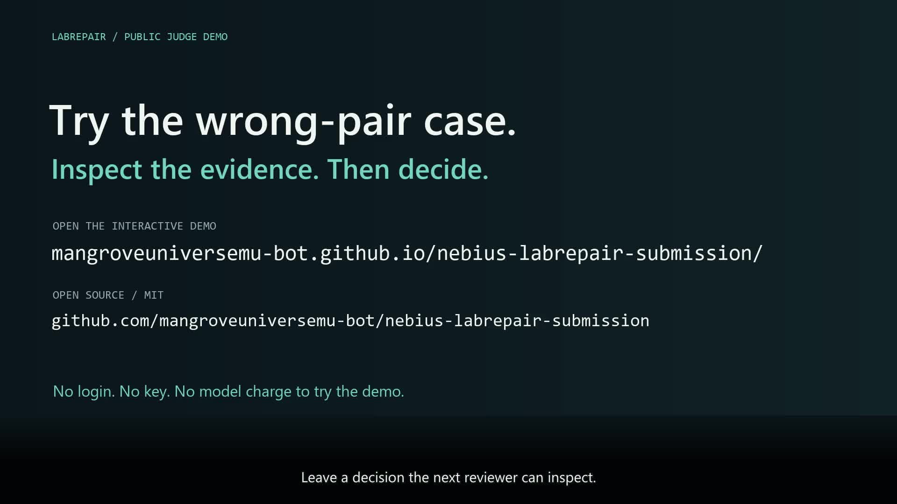

# Current public submission film / 30 October 2026

**This directory describes the current, already-prepared public-ending film.**
The older `../demo-20261030-live-review/render_live_review.py` generated the
historical private review cut. Its `Private review build` ending is archival,
not the ending of the current movie.

- Current filename: **`LabRepair_DEMO_Public_20261030.mp4`**
- Duration: **123 seconds**; 1920 × 1080; 25 fps; natural English male narration.
- Bytes: **12,468,647**.
- SHA-256: **`df520bcf87b50d80e34805783462f030f18d386a1009ed4c1696609267e3b887`**.
- [Interactive public judge demo](https://mangroveuniversemu-bot.github.io/nebius-labrepair-submission/)
- [Public source repository](https://github.com/mangroveuniversemu-bot/nebius-labrepair-submission)
- [Public YouTube film](https://www.youtube.com/watch?v=ZTwxr5o-MIM): published on
  Mangrove-Universe; playback observed, upload copyright check reported no issues.
- Owner's existing [Drive preview](https://drive.google.com/file/d/1G4mSo6diaacyMf_W0y93G1jd0uTKhhRk/view):
  **private access**, not the public YouTube submission link.

The MP4 is a delivery artifact, not embedded in this source folder. The owner
workspace's current delivery is `outputs/nebius-publication-20261030/video/`.
The uploaded source matched the filename and digest above. The separate
`evidence/youtube_publication_20261030.json` records publication/playback. Devpost
registration and final submission are still pending; publication of this film
does not submit a hackathon entry.

## Inspect the actual ending



The final seven seconds show the **public submission** demo and repo URLs.
There is no `Private review build` label or link to the private development repo.
`public-endcard.png` is the design input; `qa/actual-*.jpg` are frames decoded
from the actual final MP4. `media_verification.json` records the original full
decode, unchanged AAC payload, all 35 subtitle intervals and sampled-frame review.
`current_movie_readback.json` is a later independent re-read of that same MP4.

## What changed, and what did not

Only the 116–123 second picture was editorially replaced. Earlier picture content
was retained through one additional H.264 encode. Original AAC narration is
bit-identical, and the English SRT is unchanged. The existing Nemotron/Token
Factory and Sandbox footage remains historical evidence, not a new run or a
continuous live capture. No TTS, provider or paid service call was made for this
edit. The original 3.40 claim remains NOT_REPRODUCED.

The hosted demo later gained a case-C table clarification showing its three
available values. The movie retains its recorded interface footage; its current
public ending and exact file identity are specified above.

## Renderer scope and prerequisites

`render_public_endcard.py` is a **portable end-card derivative renderer**. It does
not recreate the whole film from raw animations, UI footage or narration. A
fresh public-repo clone alone does not supply the predecessor MP4 or font files.

Required existing inputs and software:

- Python 3.12; Pillow for rendering; an explicit FFmpeg executable with libx264
  and libass. Nothing is downloaded or installed automatically.
- Predecessor `LabRepair_DEMO_LiveReview_20261030.mp4`, SHA-256
  `9ab36becebe9b4061e9ecc62e607cff88f0b84bc6c9065079d3df4ced56e531a`.
- The exact predecessor ASS (`predecessor-captions.ass` is included) and supplied
  English SRT; both are checked against pinned SHA-256 values.
- Explicit regular, semibold and monospace font-file paths. The prepared film
  used Segoe UI, Segoe UI Semibold and Consolas from the owner's existing system.
  Those font binaries are not redistributed. Other fonts can change layout.
- An output directory distinct from the source movie; an existing movie is not
  overwritten. The only allowed Pages URL is the reviewed public submission URL.

Read back the existing current movie without rendering, Pillow or network access:

```sh
python media/demo-public-20261030/render_public_endcard.py \
  --ffmpeg /path/to/existing/ffmpeg \
  --output-dir /path/to/readback \
  --verify-existing /path/to/LabRepair_DEMO_Public_20261030.mp4
```

Rebuild a derivative from the exact predecessor, after checking public access:

```sh
python media/demo-public-20261030/render_public_endcard.py \
  --ffmpeg /path/to/existing/ffmpeg \
  --source-movie /path/to/LabRepair_DEMO_LiveReview_20261030.mp4 \
  --font-regular /path/to/segoeui.ttf \
  --font-semibold /path/to/seguisb.ttf \
  --font-mono /path/to/consola.ttf \
  --output-dir /path/to/new-render \
  --pages-url https://mangroveuniversemu-bot.github.io/nebius-labrepair-submission/ \
  --verified-at-utc 2026-10-30T09:34:17Z
```

The timestamp is the recorded access verification used for the prepared movie;
operators must provide their own actual recheck time for a later render. A
rebuild is verified for duration/decode/AAC/subtitles; byte-identical output across
different FFmpeg or font versions is not promised. Human end-frame inspection is
still required after any rebuild.

The delivered MP4 was made by the original local version of this derivative
procedure. This path-refactored source passed syntax and actual-film readback
checks; its render mode was not rerun merely to change file organization.
